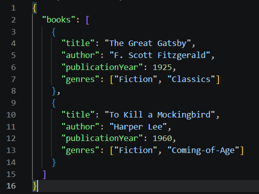
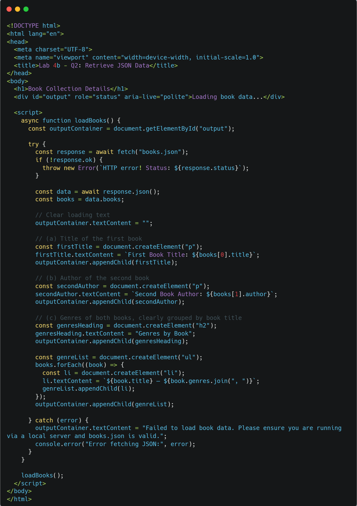
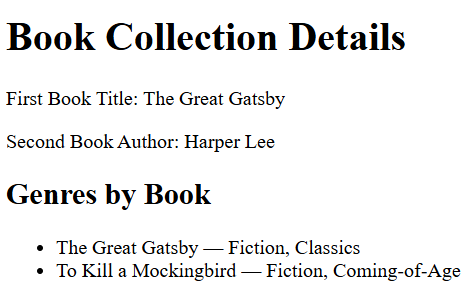
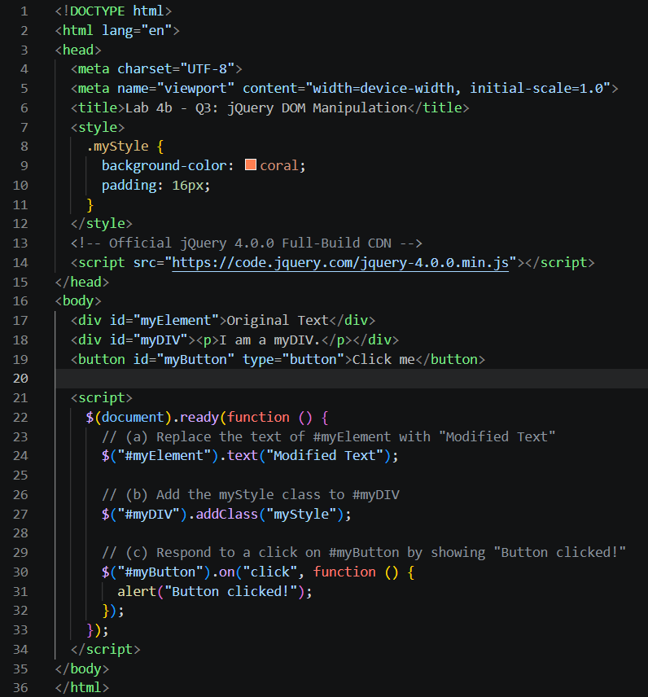
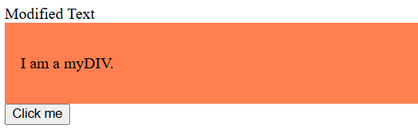
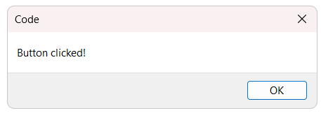

# BIC21203 Lab 4b – Client-Side Scripting (JSON and jQuery)

## Student Information

- **Name:** Muhammad Muqry Haqimy Bin Mohd Azli
- **Student ID:** CI250118
- **Course:** BIC21203 – Web Development
- **Academic Session:** 2026/2027
- **Lab:** Lab 4b – Client-Side Scripting (JSON and jQuery)

---

## Introduction

This repository contains my solutions for Lab 4b of BIC21203 Web Development. This lab focuses on client-side scripting using JSON, modern JavaScript, and jQuery.

The activities involve creating and structuring JSON data, retrieving and displaying JSON data using the JavaScript Fetch API, and implementing DOM manipulation and event handling using jQuery.

## Lab Objectives

- Create and structure valid JSON data.
- Retrieve JSON data using the JavaScript `fetch()` API.
- Parse and access specific data from JSON objects.
- Display JSON data dynamically on a webpage.
- Understand the differences between native JavaScript and jQuery.
- Apply jQuery methods for DOM manipulation and event handling.

---

## Project Structure

```text
bic21203-lab4b-json-jquery/
│
├── Q1/
│   └── books.json
│
├── Q2/
│   └── books.html
│
├── Q3/
│   └── jquery-dom.html
│
└── README.md
```

---

## Question 1 – Create and Structure JSON Data

### Description

Create a valid JSON file named `books.json` containing a collection of two books. Each book contains its title, author, publication year, and genres.

### JSON Data Structure

The JSON file contains the following information:

| Property | Book 1 | Book 2 |
|---|---|---|
| Title | The Great Gatsby | To Kill a Mockingbird |
| Author | F. Scott Fitzgerald | Harper Lee |
| Publication Year | 1925 | 1960 |
| Genres | Fiction, Classics | Fiction, Coming-of-Age |

### Concepts Used
- JSON Objects
- JSON Arrays
- Key-Value Pairs
- String, Number and Array Data Types

### How to Run
1. Open the `Q1` folder.
2. Open `books.json` using Visual Studio Code.
3. Check the JSON structure and data.
4. Ensure the JSON file contains no syntax errors.

### Screenshot

#### Code 

---

## Question 2 – Retrieve and Display JSON Data

### Description

Create a webpage named `books.html` that retrieves data from `books.json` using the native JavaScript `fetch()` API and displays selected information on the webpage.

### Required Output

The webpage displays:

- Title of the first book: The Great Gatsby.
- Author of the second book: Harper Lee.
- Genres of both books, grouped according to their respective titles.

### Concepts Used
- JavaScript Fetch API
- JSON Parsing
- Promises / Async and Await
- DOM Manipulation
- `textContent`
- Error Handling

### How to Run

1. Open the project folder in Visual Studio Code.
2. Start a local development server using the Live Server extension.
3. Open `books.html` through Live Server.
4. The webpage will retrieve and display the information from `books.json`.
5. Check that the required book information is displayed correctly.

**Note:** Do not open the HTML file directly using `file://`. A local development server is required for the `fetch()` request to work correctly with the local JSON file.

### Screenshot

#### Code 
#### Output 

---

## Question 3 – Compare Native JavaScript and jQuery

### Description

Create a webpage named `jquery-dom.html` to demonstrate DOM manipulation and event handling using jQuery.

The webpage implements three operations:

1. Change the text inside `#myElement` from "Original Text" to "Modified Text".
2. Add the `myStyle` CSS class to `#myDIV`.
3. Display an alert message "Button clicked!" when the user clicks the button.

### jQuery Methods Used

| Native JavaScript | jQuery |
|---|---|
| `textContent` | `.text()` |
| `classList.add()` | `.addClass()` |
| `addEventListener()` | `.on("click", ...)` |

### Concepts Used
- jQuery Library
- DOM Manipulation
- `.text()`
- `.addClass()`
- `.on("click", ...)`
- Event Handling
- CSS Class Manipulation

### How to Run

1. Open the `Q3` folder.
2. Open `jquery-dom.html` in a web browser.
3. Ensure you have an internet connection to load the jQuery CDN.
4. Observe the modified text and CSS styling.
5. Click the **Click me** button to display the alert message.

**jQuery CDN:**

https://code.jquery.com/jquery-4.0.0.min.js

### Screenshot

#### Code 
#### Output 


---

## Technologies and Tools Used

- HTML5
- JavaScript
- JSON
- jQuery 4.0.0
- Visual Studio Code
- Google Chrome / Microsoft Edge
- GitHub
- VS Code Live Server

---

## Conclusion

Through this lab, I gained practical experience in handling JSON data and using jQuery for DOM manipulation. I learned how to create structured JSON files, retrieve data using the Fetch API, and display the information dynamically on a webpage. I also gained a better understanding of the differences between native JavaScript and jQuery, particularly in manipulating webpage elements and handling user events. Overall, this lab improved my understanding of client-side scripting and interactive web development.

---

**Course:** BIC21203 – Web Development  
**Lab:** 4b – Client-Side Scripting (JSON and jQuery)